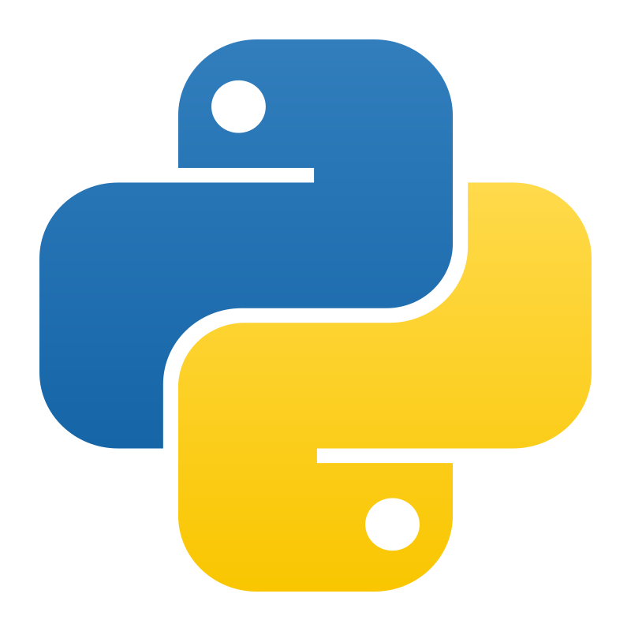

---
---

  

  

    <h1 style="margin-top: 0;">Presentación</h1>

    
Soy economista y estudiante de maestría en Ciencia de Datos, con experiencia en análisis económico, investigación aplicada y evaluación de políticas públicas.

    
Esta página reúne mis proyectos de investigación, análisis de datos y documentación de métodos cuantitativos, así como estudios sobre historia.

  

## Áreas de interés

- Economía aplicada y políticas públicas.
- Ciencia de datos y métodos cuantitativos.
- Educación y mercado laboral.
- Investigación histórica.

## Herramientas de trabajo

  

  

  

  
  

    <strong>Apoyo de inteligencia artificial:</strong>
    Empleo herramientas de OpenAI para apoyar el desarrollo y la revisión de código en mis proyectos de investigación.
  

## Proyectos de investigación

### Educación universitaria en el Perú

Análisis de las transformaciones de la población universitaria peruana entre 1996 y 2024, utilizando los censos universitarios de 1996 y 2010 y los registros administrativos del portal TUNI.

[Ver repositorio](https://github.com/DanielPajita/educacion-universitaria-peru)

## Perfiles profesionales

  <a href="https://github.com/DanielPajita"
     style="display: inline-flex; align-items: center; gap: 8px; text-decoration: none;">
    
    GitHub
  </a>

  <a href="https://www.linkedin.com/in/daniel-leandro-pajita-dominguez-93657a265/"
     style="display: inline-flex; align-items: center; gap: 8px; text-decoration: none;">
    
    LinkedIn
  </a>

